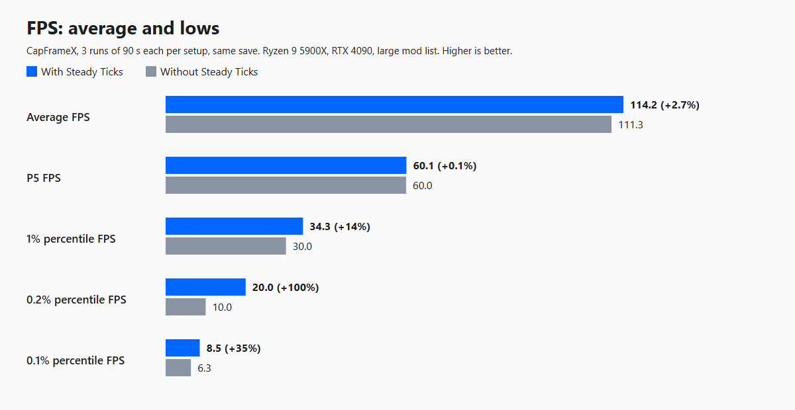
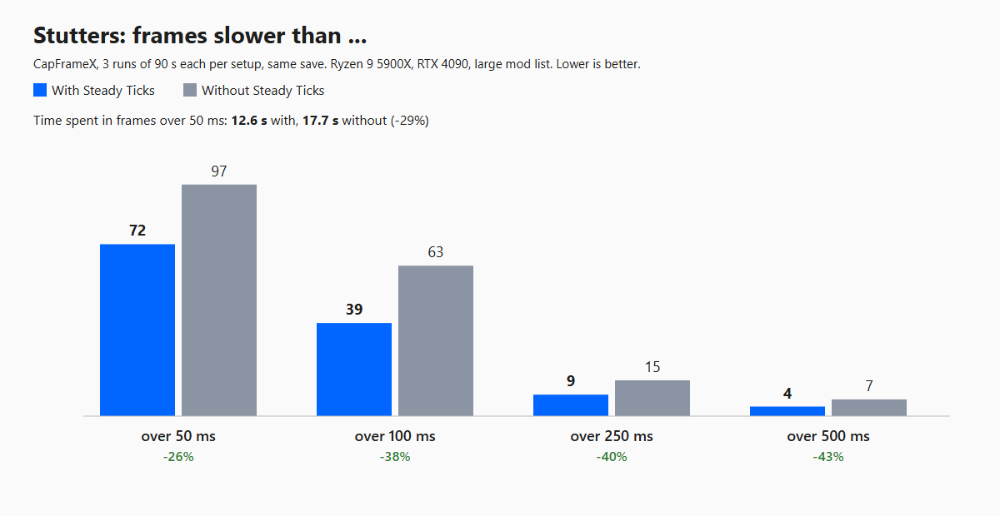
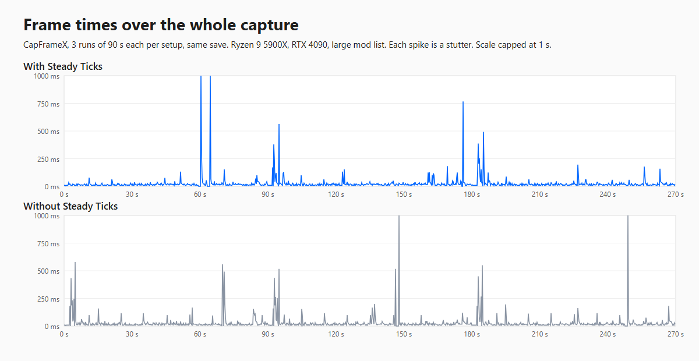
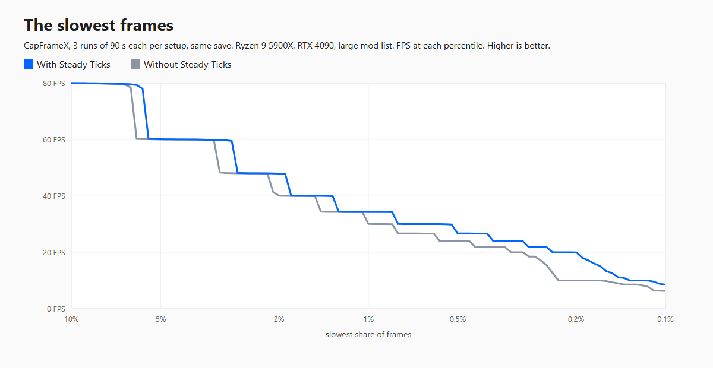

# Steady Ticks

Fewer campaign map stutters for Mount & Blade II: Bannerlord.

## What it does

Bannerlord already spreads most per-party, per-settlement and per-hero work across each in-game hour. The global hourly, daily and weekly ticks are the exception: every game system and every mod that listens to them runs in the same frame, which shows up as a stutter on the hour and a bigger one at midnight.

- **Spread ticks.** When the hourly, daily or weekly tick fires, Steady Ticks queues its listeners (the game's and, by default, other mods') in their original order and runs them over the following frames within a small time budget. Every listener still runs exactly once per tick, within the same in-game hour, and anything left is finished before the next hour and before a save.
- **Learned scheduling.** It measures how long each listener takes while you play. A heavy listener gets a frame to itself and light ones are packed together. If the queue would not finish before the next in-game hour, the budget grows to make it.
- **Hero healing.** Heroes outside a party heal every 4 hours by 4 hours' worth instead of every hour. Healing per day is unchanged.
- **Slow down distant AI (optional, off by default).** Parties far outside your sight rethink their plans every 12 hours instead of 6. Nearby parties, armies, battles, sieges and forced rethinks are never slowed.
- **Profiler (optional, off by default).** Measures FPS and where campaign map time goes: every listener of every campaign event from the game and every mod, per-mod totals, battles, encounters, world size and memory over time. Useful for finding which mod slows a long campaign down.

Steady Ticks never patches other mods. It works on the game's own event lists, so new mods and mod updates are picked up automatically.

## What to expect

The gain depends on your mod list. In a heavily modded campaign (about 2,200 parties, 30+ mods with tick listeners), CapFrameX measured over 3 runs of 90 seconds each on the same save: average FPS +2.7%, 1% percentile FPS +14% (30.0 to 34.3), 0.2% percentile FPS about doubled (10.0 to 19.9), and 38% fewer frames slower than 100 ms (63 to 39). The frames on the hour and at midnight no longer stack every listener at once.

A single listener that is slow on its own still takes as long in its own frame: Steady Ticks moves work, it never skips or splits it.






The charts are made from CapFrameX captures with `tools/charts` (see Building).

## Requirements

- Bannerlord v1.4.8 (built and tested against it; War Sails / NavalDLC supported but not required)
- [Harmony](https://www.nexusmods.com/mountandblade2bannerlord/mods/2006) (Bannerlord.Harmony v2.4.2 or newer)
- [Mod Configuration Menu (MCM) v5](https://www.nexusmods.com/mountandblade2bannerlord/mods/612) (v5.12 or newer)

Load order: Harmony, then MCM, then the game's modules, then Steady Ticks. Safe to add to an existing save and to remove again (it stores nothing in the save).

## Settings (MCM)

| Setting | Default | What it does |
|---|---|---|
| Spread Hourly and Daily Ticks | On | Spreads the hourly, daily and weekly tick work over the next frames. |
| Time Per Frame (ms) | 2.0 | Work budget per frame for the spread ticks (raised automatically when needed to finish within the hour). |
| Spread Other Mods Too | On | Also spreads other mods' hourly, daily and weekly work. |
| Heal Heroes Every 4 Hours | On | Heroes outside a party heal in 4-hour steps (same healing per day). |
| Slow Down Distant AI | Off | Distant parties rethink half as often (x2 to x4). |
| Enable Profiler | Off | Writes performance reports to the ModLogs folder. |

With a campaign loaded, a second page, **Steady Ticks: Mods**, lists every mod with hourly, daily or weekly code. All are ticked (spread) by default; untick a mod to keep its code running exactly on the hour.

## Compatibility

- Works alongside Performance Optimizer and other performance mods; they optimize different things.
- Mods that read the result of the game's hourly or daily work on the exact same frame see it a few frames later. If one ever misbehaves, untick it on the Steady Ticks: Mods page.
- After a game update, check `SteadyTicks.log` (see below). If a patch no longer fits, that feature turns itself off instead of crashing.

## Logs

Steady Ticks writes no files unless the profiler is on or something goes wrong. Then it writes `SteadyTicks.log` to `Documents\Mount and Blade II Bannerlord\Configs\ModLogs`.

With the profiler on it also writes, every 10 seconds of map time:
- `SteadyTicks.profile.csv`: FPS, 1% lows, time per campaign system, world size and memory, one row per report.
- `SteadyTicks.listeners.csv`: every listener's cost per report, with the in-game date.
- `SteadyTicks.summary.log`: totals for the session by mod and by listener.
- `SteadyTicks.patches.log` (once per session): every game method other mods patch with Harmony.

Turning the profiler on causes a short pause while it sets up timing for every listener; turning it off removes it again.

## Building

Requires Visual Studio 2022 (or the .NET SDK with MSBuild) and a Bannerlord install.

1. Copy `SteadyTicks.local.props.example` to `SteadyTicks.local.props` and set your paths (or set `BANNERLORD_GAME_DIR`).
2. Build: open `SteadyTicks.sln` in Visual Studio and build **Stable_Release | x64**, or from a command line:
   ```
   MSBuild SteadyTicks.sln -restore -p:Configuration=Stable_Release -p:Platform=x64
   ```
   The build fills `dist\SteadyTicks` with a ready-to-install module and, for Release, makes `dist\SteadyTicks-<version>.zip`. It never writes into the game folder or your mod manager. To also copy the module to `ModsDeployFolder` from the local props, add `-p:DeployToMods=true`.
3. Optional offline check: `tools\PatchCheck` applies every patch against the installed game and tests the spreading order.
   ```
   MSBuild tools\PatchCheck\PatchCheck.csproj -restore
   tools\PatchCheck\bin\Debug\net472\PatchCheck.exe
   ```

4. Optional charts: export two CapFrameX captures (with and without the mod) as JSON, then
   ```
   node tools\charts\capframex-charts.js with.json without.json <outDir>
   powershell -File tools\charts\render.ps1 -Dir <outDir>
   ```
   The first writes the charts as HTML, the second turns them into PNG with headless Chrome.

## License

See [LICENSE](LICENSE).
